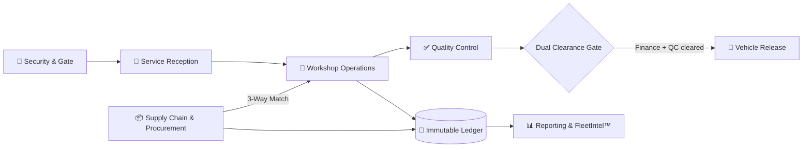

 

 

 

## 👋 About

I'm a **Technical Product Manager who also writes the code**. I take manual, paper-based operations and turn them into **auditable, compliant, data-driven platforms** — owning the whole path from requirements and architecture to production rollout and user training.

- 🏗️ **Now:** Product Owner and architect of **GarageOne ERP** for NCG Holdings Group
- 🧩 **Sweet spot:** ERP design, CRM implementation, workflow automation, financial controls
- 🤖 **How I build:** AI-native — Claude Code, Supabase, MCP, CI with security gates
- 🎓 **BSc (Hons) Computer Science — Software Engineering**, University of Wolverhampton
- 🤝 **Open to:** remote product management, CRM consulting, automation architecture

 

## 🚀 Featured: GarageOne ERP

> Purpose-built automotive operations platform for NCG Holdings Group — from blank repo to production, multi-branch, with a full financial compliance engine.

<table>
<tr>
<td align="center" width="16%"><h3>12</h3>production modules</td>
<td align="center" width="16%"><h3>13</h3>RBAC roles</td>
<td align="center" width="16%"><h3>550+</h3>commits in 2.5 months</td>
<td align="center" width="16%"><h3>4</h3>sprint phases</td>
<td align="center" width="16%"><h3>118</h3>page architecture manual authored</td>
<td align="center" width="16%"><h3>5</h3>departments trained</td>
</tr>
</table>

**How a vehicle moves through the system**

**Architecture decisions that matter**

| Decision | Why it's there |
|---|---|
| **Immutable Ledger** | Financial records are append-only — corrections are new entries, so every figure is traceable |
| **3-Way Match** | Purchase order, goods received, and invoice must agree before money moves |
| **Zero-Trust RBAC** | 13 roles enforced at the database with Row-Level Security, not just in the UI |
| **Multi-Entity Isolation** | Branches and entities share one platform without seeing each other's data |
| **4-Tier SLA Escalation** | Amber → Red → Executive → Chairman, so stalled jobs surface automatically |
| **Dual Clearance Gate** | No vehicle leaves until both quality and finance sign off |

<b>📦 All 12 modules</b>

 

| Operations | Supply & Finance | Platform |
|---|---|---|
| Security & Gate | Supply Chain | Access Control |
| Service Reception | Procurement | Notifications |
| Workshop Operations | Financial Control | Reporting & Analytics |
| Quality Control | Human Resource | FleetIntel™ |

 

## 💼 What I've delivered

| Company | What I did |
|---|---|
| **NCG Holdings Group** | Created and architected GarageOne ERP — 12 modules, 13 roles, Immutable Ledger, full financial compliance engine |
| **Aitken Spence Group** | Enterprise CRM for freight & travel · presented to the Group CIO · designed BI dashboards · planned Gensoft ERP integration |
| **JDN Designs** | End-to-end Bitrix24 CRM — 4 pipelines, lead-to-deal automation, custom fields, full UAT |
| **Dreamron** | WhatsApp chatbot + Bitrix24 CRM on TARS + n8n — automated lead capture and counsellor assignment |
| **Daraz · Alibaba Group** | Pricing & BI analytics — contributed to a 20% revenue increase during the 11.11 campaign |
| **Fits Cargo** | Integrated 6 cargo APIs — Cargo.one, WebCargo, CargoAi, Airblox, CPS, CargoBooking |

 

## 🛠️ Tech stack

  

  

 

| Area | What I work with |
|---|---|
| **Architecture** | Immutable Ledger · Zero-Trust RBAC · 3-Way Match · Event Sourcing · Multi-Entity DB |
| **Infrastructure** | Supabase · PostgreSQL · Row-Level Security · Docker · CI/CD with security gates |
| **Product** | ERP Design · Roadmaps · PRDs · Agile/Scrum · UAT · User Story Mapping |
| **Automation** | n8n · Bitrix24 SPA · Make.com · WhatsApp Business API · Telegram Bot API |
| **Frontend** | React · TypeScript · Vite · Figma · i18n (EN / SI / TA) |
| **Data & BI** | Power BI · SQL · Python · Predictive Analytics · Dashboard Design |

 

## 📊 GitHub activity

 

 

<picture>
  <source media="(prefers-color-scheme: dark)" srcset="https://raw.githubusercontent.com/ishrafahamed/ishrafahamed/output/github-contribution-grid-snake-dark.svg" />
  <source media="(prefers-color-scheme: light)" srcset="https://raw.githubusercontent.com/ishrafahamed/ishrafahamed/output/github-contribution-grid-snake.svg" />
  
</picture>

 

## 🎯 Currently

- 🟢 **Technical Product Manager** — GarageOne ERP, NCG Holdings Group
- 🔨 **Building:** Bank Reconciliation, Fixed Assets, and a read-only MCP server so finance can query the ERP in plain language
- 📚 **Certifications in progress:** PSPO I · Google Prompting Essentials · IBM Business Analyst · IIBA ECBA

 

### Let's build something that runs in production

Open to remote product management, CRM consulting, and automation architecture roles.

